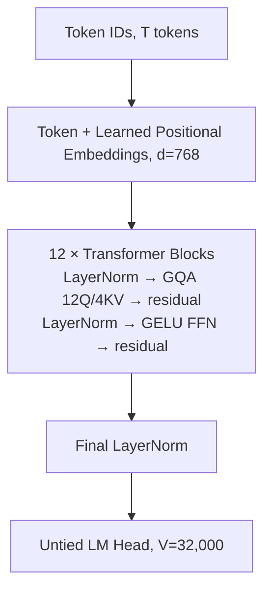
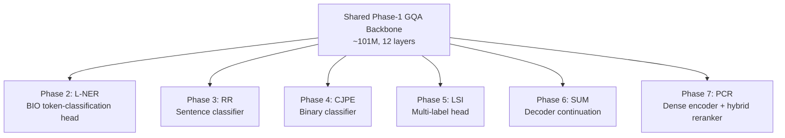

# CS781 Capstone Project: In-House Legal Intelligence System

**Student:** Himangshu Mahato  
**Roll Number:** 261110027  
**Email:** himangshum26@iitk.ac.in  
**Institution:** Indian Institute of Technology Kanpur (IIT Kanpur)  
**Codabench Username:** h_261110027  
**GitHub Repository:** https://github.com/Himangshu32/CS781-Legal-Intelligence-System  
**Final Report:** [report/CS781-CP-Himangshu-Mahato-261110027-report.pdf](report/CS781-CP-Himangshu-Mahato-261110027-report.pdf)

---

## 1. Abstract & System Overview

This repository contains the complete codebase, experimental logs, preprocessing scripts, checkpoints, and final report for the CS781 Capstone Project. The objective was to design, pretrain, and evaluate an entirely self-hosted, confidential legal Natural Language Processing (NLP) pipeline built completely from scratch, without relying on external pretrained foundation models or closed commercial APIs.

To meet the multi-task legal intelligence challenge under a strict 50M–300M parameter limit, a custom **101M-parameter Grouped-Query Attention (GQA) causal foundation model** was pretrained on an **18.5 GB deduplicated corpus** of Indian legal texts (Acts, Supreme Court, High Courts, and Tribunals). This shared causal backbone was subsequently transferred across **six downstream phases (2–7)** using Parameter-Efficient Fine-Tuning (PEFT) techniques, task-specific decoding strategies, and hybrid retrieval mechanisms.

The pipeline spans:

| Phase | Task | Best Codabench Score |
|---|---|---|
| 1 | Legal LM Pretraining (GQA foundation) | 0.8174 |
| 2 | Legal Named Entity Recognition (L-NER) | 0.4746 |
| 3 | Rhetorical Role Prediction (RR) | 0.4244 |
| 4 | Court Judgment Prediction (CJPE) | 0.6479 |
| 5 | Legal Statute Identification (LSI) | 0.3316 |
| 6 | Abstractive Summarization | 0.8266 |
| 7 | Prior Case Retrieval (PCR) | 0.4312 |

---

## 2. Architecture

### 2.1 Phase-1 GQA Foundation Model

The final foundation model (**Model 3**) uses Grouped-Query Attention with the following configuration:

| Component | Value |
|---|---|
| Embedding dimension (`n_embd`) | 768 |
| Transformer layers | 12 |
| Query heads | 12 |
| KV heads | 4 (3 query heads per KV head) |
| Context length | 1024 tokens |
| Tokenizer vocab | 32,000 (byte-level BPE) |
| Parameters (excluding untied LM head) | 101.0M |
| Parameters (including untied LM head) | ~126M |
| Norm / activation / positions | LayerNorm, GELU FFN, learned positional embeddings <!-- TODO: confirm exact config from Model 3 checkpoint --> |



Three other architectures were trained for comparison: a GPT-2 baseline (110.4M body), a SwiGLU + RMSNorm variant (110.4M body), and a Prefix-LM (101.6M body).

### 2.2 Custom Tokenizer

- Byte-level BPE, vocabulary size **32,000**
- Trained on a **32 MB deduplicated sample** of the four official Phase-1 sources
- Unicode-aware regex pre-tokenization via the `regex` library
- Fertility: **1.205 tokens/word** on official test prompts; **1.248** on the corpus sample
- Reference: GPT-2's tokenizer is typically 1.3–1.4 tokens/word on general English (cited typical value, not a same-corpus measurement)
- Round-trips Devanagari losslessly but compresses it at ~10 tokens/word; 0 of 1,000 test prompts contain Devanagari

### 2.3 Transfer Protocol

All downstream phases initialize from the Phase-1 GQA weights. PEFT methods used across the pipeline: **LoRMA (own implementation)**, **LoRA**, **IA3**, **AdaLoRA**, **Houlsby-style Adapters**, **Prefix Tuning**, **Prompt Tuning**, and **Knowledge Distillation** (half-layer students).



---

## 3. Dataset

- **Source:** `Exploration-Lab/CS-781-Capstone` (Hugging Face Datasets)  
  https://huggingface.co/datasets/Exploration-Lab/CS-781-Capstone
- **Raw file sizes:** Acts 0.73 GB, High Courts 10.67 GB, Supreme Court 1.32 GB, Tribunals 6.48 GB (total 19.2 GB)
- **Post-deduplication training corpus:** ~18.5 GB
- **Cleaning:** removed control characters (kept newlines and tabs), collapsed repeated whitespace and blank lines, stripped leading/trailing whitespace, exact-duplicate filtering by hash of first 500 cleaned characters. **Section numbers and citation formats were deliberately preserved** because Phases 2 and 5 depend on them.
- **Data is not redistributed in this repository.** All scripts load the dataset from Hugging Face.

Per-phase splits:

| Phase | Train | Dev | Test |
|---|---|---|---|
| 1 | Full corpus (four sources) | held-out sample | 1,000 prompts (~512 words each) |
| 2 | 70 docs (fold1 35, fold2 35) | fold2 (for checkpoint selection) | 35 docs (fold3) |
| 3 | CL 10,593 + IT 6,252 sentences | dev split | held-out |
| 4 | 37,387 | 3,505 | 1,517 |
| 5 | 42,750 | 10,181 | 13,019 |
| 6 | 6,730 | 300 held out (150 for final reporting) | 100 |
| 7 | 827 queries / 4,320 candidates / 5,308 positive pairs | 118 queries / 1,023 candidates | 237 queries / 1,727 candidates |

---

## 4. Methodology & Implementation (Per Phase)

### 4.1 Phase 1 — Legal LM Pretraining

- **Task:** causal language modeling, 1024-token context.
- **Backbones compared:** GPT-2 baseline (110.4M), RMSNorm+SwiGLU (110.4M), GQA (101.0M), Prefix-LM (101.6M).
- **Data mixing:** all four sources concatenated; bimodal length distribution (High Court ~2.5 KB/doc vs. 13–16 KB/doc for Acts/SC/Tribunals) informed the 1024-token context.
- **Training:** ~24,414 steps, AdamW, peak LR 3e-4, batch 4 × grad-accum 2, FP16 autocast, gradient clipping 1.0.
- **Decoding at submission:** top-p sampling with repetition penalty (sign-corrected) and KV cache.
- **Best model:** GQA, Codabench **0.8174**.
- **Files:** `code/phase1/` <!-- TODO: list exact filenames: train_tokenizer.py, train_lm.py, configs/, generation.py -->
- **Key bugs fixed:** (1) generation slice index under left-padding, (2) repetition-penalty sign, (3) Prefix-LM loss leakage inside the bidirectional prefix (validation perplexity ~2.2 → corrected ~18 after masking prefix label positions with -100).

### 4.2 Phase 2 — Legal Named Entity Recognition

- **Task:** token classification over 12 entity types, 25 BIO tags, strict character-offset evaluation.
- **Backbone:** frozen Phase-1 GQA.
- **Best method:** **LoRMA** (r=8, α=16) on q, k, v, and MLP projections, ~1.15M trainable params (~1.1%). Linear(768, 25) BIO head.
- **Decoding:** 512-token windows, stride 256, log-probability averaging, **Viterbi-constrained BIO decoding**.
- **Loss:** class-weighted cross-entropy.
- **Span fidelity:** gold-to-token-to-gold round trip recovers 98.2% of spans.
- **Best result:** dev 0.4316, Codabench **0.4746**.
- **Comparison:** GQA full FT val 0.3335 / Codabench 0.3537; GQA + LoRA (r=32) val 0.299; GPT-2 + LoRMA val 0.1438; KD from Prefix-LM teacher val 0.1505.
- **Files:** `code/phase2/` <!-- TODO: list exact filenames -->

### 4.3 Phase 3 — Rhetorical Role Prediction

- **Task:** sentence-level classification over 13 labels (including literal `"None"`), jointly over Corporate Law (CL) and Information Technology (IT).
- **Backbone:** Phase-1 GQA (causal attention retained; bidirectional ablation run on Prefix-LM only).
- **Final system:** ensemble of six complementary models (softmax-probability averaging) + **Viterbi transition smoothing** with label-bigram prior λ=0.3.
- **Context-aware variant:** conditions target sentence on the previous two sentences.
- **Best individual model on dev:** Context-Aware GQA + Prompt Tuning, dev 0.3349 / Codabench 0.3797.
- **Best overall:** Ensemble + Transition Smoothing, dev 0.3587, Codabench **0.4244**.
- **Ablation:** Prefix-LM causal 0.2745 → bidirectional 0.3321 (+0.058), proving causal pretraining creates a structural bottleneck for sentence classification.
- **Known failure:** `Dissent` and `PrecedentOverruled` yield F1 = 0.000 (only 3 examples of the latter).
- **Files:** `code/phase3/` <!-- TODO: list exact filenames -->

### 4.4 Phase 4 — Court Judgment Prediction

- **Task:** document-level binary classification.
- **Long-document handling:** head+tail truncation, first 512 + last 256 = 768 tokens.
- **Class imbalance:** train 59:41 (22,067 / 15,320), dev ~50:50; class-weighted cross-entropy [0.847, 1.220]; class-1 logit offset only if half/half dev split shows held-out gain > 0.005.
- **Training constraint:** 12,000 of 37,387 documents sampled per epoch (fresh sample each epoch) due to Kaggle session limits.
- **Best method:** **Layer Freezing** (freeze bottom 9 of 12 layers, train top 3 + head), Codabench **0.6479**.
- **Comparison (Codabench):** Full FT 0.6460, LoRMA 0.6182, Houlsby adapters 0.5939, BitFit 0.5822, KD 0.5286.
- **Note:** Dev macro-F1 was not recovered from the notebooks before the report freeze. Checkpoint selection nevertheless used uncalibrated dev macro-F1.
- **Files:** `code/phase4/` <!-- TODO: list exact filenames -->

### 4.5 Phase 5 — Legal Statute Identification

- **Task:** multi-label classification over 100 statutes (vocabulary built from train+dev union).
- **Document lengths:** p50 638, p75 2,096, p90 4,344, p95 6,531, p99 19,962, p100 41,117 tokens; **47.0% exceed the 768-token budget.**
- **Long-document handling:** head+tail, 512 + 256 = 768 tokens.
- **Loss:** `BCEWithLogitsLoss` with per-statute `pos_weight` (inverse frequency, clipped to [1.0, 50.0]). The cap hit the median, causing systematic over-prediction (5.2–5.6 predicted vs. true 3.90), which required post-hoc threshold calibration (0.775–0.800).
- **Best method:** **GPT-2 full fine-tuning**, dev 0.3367, Codabench **0.3316**.
- **Comparison (dev / Codabench):** KD student 0.3085 / 0.3112; LoRMA 0.3032 / 0.3051; AdaLoRA 0.3004 / 0.3032; Prefix Tuning 0.2941 / 0.2925; Adapters 0.2632 / 0.2672.
- **KD result:** 6-layer GPT-2 student initialized from Phase-1 weights, combined hard-label + temperature-scaled soft-teacher BCE loss; retains ~92% of teacher dev F1.
- **Files:** `code/phase5/` <!-- TODO: list exact filenames -->

### 4.6 Phase 6 — Abstractive Summarization

- **Task:** decoder-only continuation with prompt `[document] + "Summary:" + [summary] + EOS`, loss on summary tokens only.
- **Long-document handling:** first 256 + last 96 document tokens, leaving 600 tokens for the summary inside the 1024-token context.
- **Decoding:** KV-cached greedy, repetition penalty 1.1, no-repeat 3-gram blocking, min 150 / max 600 new tokens.
- **Reference lengths:** dev 150 docs, average 958 words; generated outputs decay to 360–480 words (~40–50% compression).
- **Checkpoint selection:** dev ROUGE-L on 64 held-out docs.
- **Best result:** **SwiGLU + LoRA** (2.51M trainable, 1.82%), dev ROUGE-1 0.3757 / ROUGE-L 0.1936 / BERTScore 0.8279, Codabench **0.8266**.
- **All variants (Codabench):** LoRMA 0.8259; GPT-2 + adapters 0.8250; KD student (teacher=Exp 4) 0.8126; KD student (teacher=Exp 1) 0.8257; GQA + prompt tuning 0.8223; Prefix-LM + prefix tuning 0.7939.
- **Repetition controls are essential:** plain greedy decodes repeated 93% of trigrams at BERTScore 0.7445; penalty 1.1 + 3-gram blocking reduced to 6.8% and raised BERTScore to 0.7903.
- **Files:** `code/phase6/` <!-- TODO: list exact filenames -->

### 4.7 Phase 7 — Prior Case Retrieval

- **Task:** rank candidates per query, return exactly 7 unique IDs; primary metric Micro-F1@7.
- **Best dense method:** **KD half-layer student** (63.95M, initialized from GQA teacher's Phase-1 weights), dense F1@7 **0.2290**, Codabench 0.1996. Highest throughput (134.6 docs/s).
- **Best hybrid method:** **GQA full fine-tuning** + lexical TF-IDF, α=0.4, dev hybrid F1@7 **0.4013**, Codabench 0.1748.
- **TF-IDF baseline:** dev F1@7 **0.3980** (first 30,000 characters per document) — the strongest single method.
- **Chunk aggregation:** first chunk 0.1934 → mean aggregation 0.2268 (**+17.3% relative**). MaxSim 0.2257. Oracle upper bound 0.6181.
- **Diagnostics:** 25.4% of dev queries return zero hits in top-7; median rank of a relevant candidate is 42; Recall@7 drops to 0.145 for queries with >7 gold candidates.
- **Final submission:** Codabench **0.4312** (submission 1039081), improving on 1039085 (0.4105). <!-- TODO: describe the exact difference between 1039081 and 1039085, including whether any transductive step (dual-softmax across test queries) was used; flag against competition rules. -->
- **Files:** `code/phase7/` <!-- TODO: list exact filenames -->

---

## 5. Execution Instructions

### 5.1 Environment

```bash
# Python 3.10+ recommended
python -m venv venv
source venv/bin/activate        # on Windows: venv\Scripts\activate
pip install -r requirements.txt
```

`requirements.txt` should contain (minimum):

```
torch>=2.0
numpy
pandas
scikit-learn
transformers>=4.30
datasets>=2.12
tokenizers
sentencepiece
matplotlib
tqdm
regex
bert-score
rouge-score
peft>=0.7
accelerate
```

<!-- TODO: verify versions against the environment you actually used. -->

**Hardware:** all experiments were developed for NVIDIA Tesla T4 (16 GB) on Kaggle/Colab. Full-fine-tuning runs and KD runs require careful FP16 autocast + micro-batching; KD Phases 2 and 5 hit OOM at full precision.

### 5.2 Data Setup

All scripts expect the dataset to be downloaded by the Hugging Face `datasets` library:

```python
from datasets import load_dataset
ds = load_dataset("Exploration-Lab/CS-781-Capstone", "phase1")
```

<!-- TODO: confirm the exact config names for each phase (phase1, phase2, etc.) against the dataset card. -->

### 5.3 Phase 1

```bash
cd code/phase1

# 1. Train the custom 32k byte-level BPE tokenizer
python train_tokenizer.py \
    --output_dir tokenizer/ \
    --vocab_size 32000 \
    --sample_mb 32

# 2. Train the GQA foundation model
python train_lm.py \
    --config configs/gqa.yaml \
    --output_dir checkpoints/phase1_gqa \
    --context_length 1024 \
    --peak_lr 3e-4

# 3. (Optional) Train the other three architectures
python train_lm.py --config configs/gpt2.yaml    --output_dir checkpoints/phase1_gpt2
python train_lm.py --config configs/swiglu.yaml  --output_dir checkpoints/phase1_swiglu
python train_lm.py --config configs/prefixlm.yaml --output_dir checkpoints/phase1_prefixlm
```

<!-- TODO: adjust file names to match your repository. -->

Expected runtime: ~24,414 steps; the GQA run is the longest. Use gradient accumulation if VRAM < 16 GB.

### 5.4 Phases 2–7

Each phase follows the same pattern: train, evaluate on the held-out dev split, then generate the Codabench submission CSV.

```bash
cd code/phase2
python train.py --config configs/lorma.yaml --output_dir checkpoints/phase2_lorma
python evaluate.py --checkpoint checkpoints/phase2_lorma --split dev
python predict.py --checkpoint checkpoints/phase2_lorma --output submission_phase2.csv

# Repeat analogously for phase3/, phase4/, phase5/, phase6/, phase7/.
```

<!-- TODO: for each phase, replace the file names above with the actual scripts. If you used a single notebook per phase (as in your Phase 3 and Phase 5 logs), point the reader to the notebook instead and say so here. -->

**Phase-specific notes**

- **Phase 2:** 512-token windows, stride 256; Viterbi BIO decoding is mandatory (invalid transitions otherwise tank strict span F1).
- **Phase 3:** the reported best result is an ensemble of six models + Viterbi transition smoothing; both must be run to reproduce Codabench 0.4244.
- **Phase 4:** 12,000 documents per epoch (randomly resampled); do not run full-dataset epochs, they exceed the Kaggle session limit.
- **Phase 5:** `pos_weight` cap of 50.0 is the source of over-prediction; if re-tuning, try a lower cap (~20) and re-calibrate the threshold.
- **Phase 6:** the submitted best is SwiGLU + LoRA, not LoRMA; checkpoints and generation scripts for all variants are in `code/phase6/`.
- **Phase 7:** the final submission 1039081 must be reproduced from the reranking notebook; the earlier GQA full-FT hybrid is a different pipeline and its Codabench score is 0.1748, not 0.4312. <!-- TODO: confirm and document. -->

### 5.5 Reproducing the final submission for each phase

A convenience script `run_all_phases.sh` (or per-phase `make` targets) is provided at the repository root. `<!-- TODO: add if present. -->`

---

## 6. Codabench Submissions

Every phase met the minimum of 4 distinct submissions.

| Phase | Submission ID | Model / Variant | Score | Date |
|---|---|---|---|---|
| 1 | 954680 | earlier attempt (model not identified in log) | 0.8033 | 2026-10-01 |
| 1 | 956082 | GPT-2 baseline | 0.8044 | 2026-10-02 |
| 1 | 957131 | RMSNorm + SwiGLU | 0.8059 | 2026-10-02 |
| 1 | 958089 | **GQA (final)** | **0.8174** | 2026-10-03 |
| 1 | 961315 | Prefix-LM (post-fix) | 0.7903 | 2026-10-05 |
| 2 | 971525 | GQA (early backup) | 0.2992 | 2026-10-09 |
| 2 | 972884 | Prefix-LM + LoRA | 0.1340 | 2026-10-09 |
| 2 | 973900 | Prefix-LM full FT | 0.2440 | 2026-10-10 |
| 2 | 976498 | GQA full FT | 0.3537 | 2026-10-11 |
| 2 | 976755 | GPT-2 + LoRMA | 0.1797 | 2026-10-11 |
| 2 | 977188 | KD (student = Model 2) | 0.1615 | 2026-10-11 |
| 2 | 977539 | **GQA + LoRMA (final)** | **0.4746** | 2026-10-11 |
| 3 | <!-- TODO --> | GQA + LoRMA | 0.3527 | <!-- TODO --> |
| 3 | <!-- TODO --> | GPT-2 + IA3 | 0.3439 | <!-- TODO --> |
| 3 | <!-- TODO --> | SwiGLU + LoRA | 0.3730 | <!-- TODO --> |
| 3 | <!-- TODO --> | Prefix-LM + rsLoRA (causal) | 0.2745 | <!-- TODO --> |
| 3 | <!-- TODO --> | Prefix-LM + rsLoRA (bidirectional) | 0.3321 | <!-- TODO --> |
| 3 | <!-- TODO --> | GQA + Prompt Tuning | 0.3599 | <!-- TODO --> |
| 3 | <!-- TODO --> | KD half-layer student | 0.3765 | <!-- TODO --> |
| 3 | <!-- TODO --> | Context-aware GQA + Prompt Tuning | 0.3797 | <!-- TODO --> |
| 3 | <!-- TODO --> | Ensemble | 0.4098 | <!-- TODO --> |
| 3 | <!-- TODO --> | **Ensemble + Transition Smoothing (final)** | **0.4244** | <!-- TODO --> |
| 4 | <!-- TODO --> | GQA + LoRMA | 0.6182 | <!-- TODO --> |
| 4 | <!-- TODO --> | GPT-2 full FT | 0.6460 | <!-- TODO --> |
| 4 | <!-- TODO --> | SwiGLU + BitFit | 0.5822 | <!-- TODO --> |
| 4 | <!-- TODO --> | Prefix-LM + Houlsby adapters | 0.5939 | <!-- TODO --> |
| 4 | <!-- TODO --> | **Layer Freezing top-3 (final)** | **0.6479** | <!-- TODO --> |
| 4 | <!-- TODO --> | KD | 0.5286 | <!-- TODO --> |
| 5 | <!-- TODO --> | GQA + LoRMA | 0.3051 | <!-- TODO --> |
| 5 | <!-- TODO --> | **GPT-2 full FT (final)** | **0.3316** | <!-- TODO --> |
| 5 | <!-- TODO --> | SwiGLU + AdaLoRA | 0.3032 | <!-- TODO --> |
| 5 | <!-- TODO --> | Prefix-LM + Adapters | 0.2672 | <!-- TODO --> |
| 5 | <!-- TODO --> | GQA + Prefix Tuning | 0.2925 | <!-- TODO --> |
| 5 | <!-- TODO --> | KD student | 0.3112 | <!-- TODO --> |
| 6 | <!-- TODO --> | GQA + LoRMA | 0.8259 | <!-- TODO --> |
| 6 | <!-- TODO --> | GPT-2 + Adapters | 0.8250 | <!-- TODO --> |
| 6 | <!-- TODO --> | **SwiGLU + LoRA (final)** | **0.8266** | <!-- TODO --> |
| 6 | <!-- TODO --> | Prefix-LM + Prefix Tuning | 0.7939 | <!-- TODO --> |
| 6 | <!-- TODO --> | GQA + Prompt Tuning | 0.8223 | <!-- TODO --> |
| 6 | <!-- TODO --> | KD student (teacher=Exp 4) | 0.8126 | <!-- TODO --> |
| 6 | <!-- TODO --> | KD student (teacher=Exp 1) | 0.8257 | <!-- TODO --> |
| 7 | <!-- TODO --> | GQA + LoRMA | 0.1926 | <!-- TODO --> |
| 7 | <!-- TODO --> | GPT-2 + IA3 | 0.1589 | <!-- TODO --> |
| 7 | <!-- TODO --> | SwiGLU partial FT | 0.1500 | <!-- TODO --> |
| 7 | <!-- TODO --> | Prefix-LM + Prefix Tuning | 0.1170 | <!-- TODO --> |
| 7 | <!-- TODO --> | GQA full FT (hybrid) | 0.1748 | <!-- TODO --> |
| 7 | <!-- TODO --> | KD half-layer student (dense) | 0.1996 | <!-- TODO --> |
| 7 | 1039085 | second latest | 0.4105 | <!-- TODO --> |
| 7 | 1039081 | **final reranked pipeline** | **0.4312** | <!-- TODO --> |

**Total valid submissions:** 48 <!-- TODO: your Phase 6 log lists 7 rows (including 6b); if 6b counted as valid the total is 49. Verify the counting rule against your Codabench history before submitting. -->

<!-- TODO: fill in the Phase 3–7 submission IDs from your Codabench history. -->

---

## 7. Results Summary

| Phase | Best Variant | Dev Metric | Codabench |
|---|---|---|---|
| 1 | GQA | — | 0.8174 |
| 2 | GQA + LoRMA | 0.4316 | 0.4746 |
| 3 | Ensemble + Transition Smoothing | 0.3587 | 0.4244 |
| 4 | Layer Freezing (top 3 + head) | not recovered | 0.6479 |
| 5 | GPT-2 full FT | 0.3367 | 0.3316 |
| 6 | SwiGLU + LoRA | 0.8279 (BERTScore) | 0.8266 |
| 7 | GQA full FT hybrid (dev) / final reranked (test) | 0.4013 | 0.4312 |

Full per-phase variant tables, secondary metrics, learning curves, and error analysis are in the [final report](report/CS781-CP-Himangshu-Mahato-261110027-report.pdf).

---

## 8. Negative Results & Lessons Learned

These are documented here because they drove real design decisions:

- **Prefix-LM loss leakage (Phase 1).** Bidirectional masking inside the prefix allowed trivial copying; validation perplexity was ~2.2 instead of ~18. Fix: mask prefix label positions with -100. The corrected Prefix-LM was still the weakest Phase-1 architecture (Codabench 0.7903).
- **Full fine-tuning collapse in Phase 2.** Full FT on 35 training documents memorized party names (train APP F1 0.72 vs. validation APP F1 0.07) and scored 0.3537 on Codabench vs. LoRMA's 0.4746. LoRMA's restricted capacity forced the model to learn structure rather than names.
- **Causal attention is a structural bottleneck for sentence classification.** Prefix-LM scored 0.2745 with causal attention; restoring bidirectional attention raised it to 0.3321 (+0.058).
- **Dense retrieval loses to lexical search in legal PCR.** Best dense F1@7 was 0.2290 (KD student); a simple TF-IDF unigram baseline reached 0.3980. Only a hybrid fusion (dense + TF-IDF) recovered competitive performance.
- **`pos_weight` cap of 50.0 in Phase 5 caused systemic over-prediction** (5.2–5.6 predicted statutes/doc vs. true 3.90), which required unusually high thresholds (0.775–0.800).
- **Chunking matters for long documents.** Using only the first chunk of a judgment dropped Phase 7 F1@7 from 0.2268 (mean aggregation) to 0.1934.

---

## 9. Checkpoints

<!-- TODO: state where each checkpoint lives, or that they are not included and how long retraining takes. -->

| Phase | Checkpoint | Size |
|---|---|---|
| 1 | GQA (final) | ~100–125M params <!-- TODO: exact file size --> |
| 2 | GQA + LoRMA | ~4.8 MB adapter <!-- TODO: confirm --> |
| 3 | Context-Aware GQA + Prompt Tuning | <!-- TODO --> |
| 4 | Layer Freezing top-3 | <!-- TODO --> |
| 5 | GPT-2 full FT | ~445 MB <!-- TODO: confirm --> |
| 6 | SwiGLU + LoRA | 310.1 MB |
| 7 | KD half-layer student | 255.8 MB |

If checkpoints are not committed to the repository, host them as GitHub release assets or on Hugging Face Hub and link here.

---

## 10. Reproducibility

- All experiments use fixed random seeds; each phase directory contains a `configs/` folder with the exact seed, hyperparameters, and data sampling policy used.
- Codabench scores track dev metrics closely across most phases (e.g., Phase 5 within 0.002–0.004), which is evidence of real generalization rather than dev-set overfitting.
- Known non-determinism: cuDNN autotuning and FP16 autocast on T4 can vary final loss slightly across runs; Viterbi decoding is deterministic.
- Large-dataset phases (4 and 5) sample 12,000 documents per epoch, so exact training-set composition differs between runs unless the same seed is used.

---

## 11. Repository Structure

```
CS781-Legal-Intelligence-System/
│
├── code/
│   ├── phase1/          # Phase 1: Legal LM Pretraining & Custom Tokenizer
│   ├── phase2/          # Phase 2: Legal Named Entity Recognition (L-NER)
│   ├── phase3/          # Phase 3: Rhetorical Role Prediction
│   ├── phase4/          # Phase 4: Court Judgment Outcome Prediction (CJPE)
│   ├── phase5/          # Phase 5: Legal Statute Identification (LSI)
│   ├── phase6/          # Phase 6: Abstractive Summarization
│   └── phase7/          # Phase 7: Prior Case Retrieval (PCR) & Hybrid Reranking
│
├── report/
│   └── CS781-CP-Himangshu-Mahato-261110027-report.pdf
│
├── requirements.txt     <!-- TODO: add if not present -->
└── README.md
```

Each `code/phaseN/` directory should contain a short `README.md` with the phase-specific run command and submission IDs. `<!-- TODO: add if not present. -->`

---

## 12. Report

The full academic report is at:
`report/CS781-CP-Himangshu-Mahato-261110027-report.pdf`

It covers the seven-phase task definitions, data analysis, architecture, transfer protocol, per-phase results, error analysis, ablations, and the LLM Usage Declaration.

---

## 13. License & Citation

The code in this repository is provided for **academic evaluation only**. The dataset remains the property of the CS-781 course at IIT Kanpur and is not redistributed here. If you use any part of this work, please cite the final report above.

---
